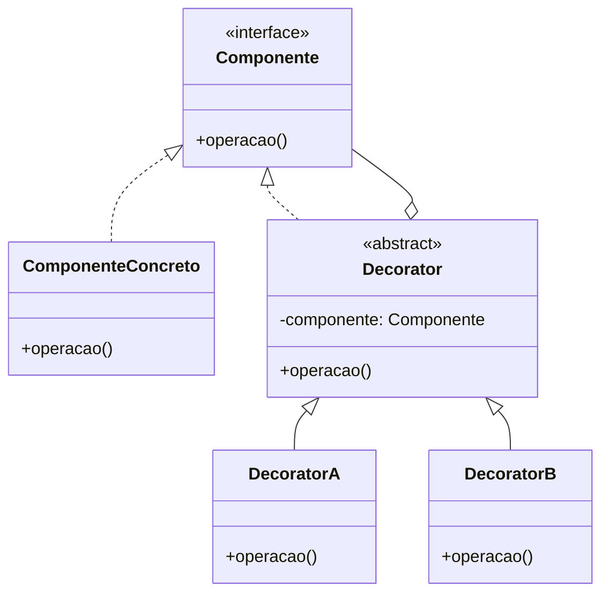

# Decorator Games

Dois joguinhos para entender, na prática, o padrão de projeto **Decorator**:

- **Café de BSI**: monte um café e vá adicionando ingredientes (chantilly, leite, chocolate, cacau, creme de avelã).
- **Vestuário Divas S.I**: vista uma boneca com peças e acessórios (blusa, calça, vestido, casaco, boné).

Trabalho para a disciplina de **PROO**, feito por **Bárbara, Kalline, Samyra e Vivian**.

> **Aviso importante:** este projeto **não é de autoria humana original**. Ele foi **criado com o auxílio de Inteligência Artificial** com o objetivo de **entender o design pattern Decorator**, representando-o de forma **visual** (frontend) e **lógica** (backend em Java).

---

## Índice

1. [O que é o Decorator?](#o-que-é-o-decorator)
2. [Decorator no Café](#decorator-no-café)
3. [Decorator no Vestuário](#decorator-no-vestuário)
4. [Como o jogo mostra o padrão](#como-o-jogo-mostra-o-padrão)
5. [Funcionalidades](#funcionalidades)
6. [Tecnologias](#tecnologias)
7. [Estrutura do projeto](#estrutura-do-projeto)
8. [API](#api)
9. [Como rodar localmente](#como-rodar-localmente)
10. [Deploy](#deploy)
11. [Créditos](#créditos)

---

## O que é o Decorator?

O **Decorator** é um padrão de projeto **estrutural**. Ele permite **adicionar comportamentos novos a um objeto dinamicamente**, "embrulhando-o" em outros objetos (os decorators), **sem alterar a classe original** e sem criar uma subclasse para cada combinação possível.

A ideia central:

- Existe um **componente** (a interface comum).
- Existe um **componente concreto** (o objeto básico).
- Existe um **decorator abstrato**, que **implementa a mesma interface** e **guarda uma referência** a outro componente.
- Cada **decorator concreto** chama o componente que está embrulhando e **acrescenta** algo ao resultado.

Como todos compartilham a mesma interface, os decorators podem ser **empilhados** em qualquer ordem e quantidade.



**Por que usar?** Sem o Decorator, seriam necessárias classes como `CafeComLeite`, `CafeComLeiteEChocolate`, `CafeComLeiteChocolateEChantilly`... uma explosão de subclasses. Com ele, cada ingrediente é **uma única classe** e as combinações acontecem **em tempo de execução**.

---

## Decorator no Café

| Papel no padrão | No projeto |
|---|---|
| **Componente** (interface) | `Cafe` |
| **Componente concreto** | `CafeSimples` |
| **Decorator abstrato** | `CafeDecorator` |
| **Decorators concretos** | `Chantilly`, `Leite`, `Chocolate`, `Cacau`, `CremeAvela` |

O **café simples** é o objeto original. Cada ingrediente **embrulha** o café e acrescenta algo à descrição e às camadas visuais.

```text
new Chocolate(new Leite(new CafeSimples()))
```

Lendo de dentro para fora:

```text
CafeSimples                → "Café simples"
  └─ Leite(...)            → "Café simples + Leite"
       └─ Chocolate(...)   → "Café simples + Leite + Chocolate"
```

Cada decorator faz basicamente isto:

```java
public String descricao() {
    return cafe.descricao() + " + Leite";   // delega ao café embrulhado e acrescenta
}
```

O jogo também devolve as **camadas** (`cafe-base`, `cafe-com-leite`, `cafe-com-chocolate`), que o frontend usa para escolher a imagem SVG correta.

---

## Decorator no Vestuário

| Papel no padrão | No projeto |
|---|---|
| **Componente** (interface) | `Avatar` |
| **Componente concreto** | a boneca base (top + short curto, "sem edição") |
| **Decorator abstrato** | decorator de vestir |
| **Decorators concretos** | `Blusa`, `Calça`, `Vestido`, `Casaco`, `Boné` |

A boneca começa com uma roupa padrão e cada peça **embrulha** o avatar, acrescentando a descrição e a camada visual correspondente:

```text
Avatar base                → "Avatar"
  └─ Boné(...)             → "Avatar + Boné"             | camadas: boneca-base, boneca-com-bone
       └─ Casaco(...)      → "Avatar + Boné + Casaco"
```

Ao clicar em **Salvar Avatar**, aparece a tela **Look final** com a boneca vestida.

---

## Como o jogo mostra o padrão

| Ação no jogo | O que acontece no Decorator |
|---|---|
| Clicar em um ingrediente/peça | Um novo decorator **embrulha** o objeto atual |
| Clicar no **** do item | O decorator é **removido** e o objeto original continua intacto, mostrando que **a classe original nunca muda** |
| **Remover alterações / Reset** | Volta ao objeto base (sem nenhum decorator) |
| Combinar vários itens | Decorators **empilhados** em qualquer ordem |
| **Salvar** | Mostra o resultado final e grava a criação no banco |

---

## Funcionalidades

- Tela inicial com a lista de jogos e os créditos da equipe.
- Tela de apresentação de cada jogo com as opções **Jogar** e **Voltar**.
- **Música de fundo** com botão para ativar/desativar (a mesma nos dois jogos).
- **Café:** menu lateral direito fixo com botões de ingredientes, destaque verde quando o item está ativo, botão  para remover, **Salvar café** e **Remover alterações**.
- **Vestuário:** boneca à esquerda e menu de peças à direita (cerca de 45% da tela), com **Salvar avatar** e **Reset**.
- Seta de voltar com alerta de confirmação ("suas alterações serão perdidas").
- Tela final: "Parabéns! Seu café com ... foi feito!" e "Look final".
- Visual minimalista, fonte arredondada estilo anos 2000, cores pastel (roxo, rosa, azul, verde) e botões de ação em vermelho e verde vivos.
- Imagens em SVG para o café base e todas as combinações.

---

## Tecnologias

| Camada | Tecnologia |
|---|---|
| Backend (lógica do Decorator) | **Java 21**, **Spring Boot 3.3**, Spring Data JPA, Hibernate |
| Banco de dados | **PostgreSQL** hospedado no **Neon** |
| Frontend | **Next.js 15** (React, TypeScript) |
| Imagens | SVG |
| Protótipo | Lovable |
| Deploy (backend) | Render |
| Deploy (frontend) | Vercel |

---

## Estrutura do projeto

```text
decorator-games/
├── backend/
│   ├── pom.xml
│   └── src/main/
│       ├── java/br/edu/decorator/
│       │   ├── cafe/          # Cafe, CafeSimples, CafeDecorator, Chantilly, Leite, Chocolate, Cacau, CremeAvela, CafeMontador
│       │   ├── vestuario/     # Avatar, decorators de roupa, AvatarMontador
│       │   ├── persistencia/  # Criacao (entidade) e CriacaoRepository
│       │   ├── web/           # JogoController, CorsConfig, Dtos
│       │   └── DecoratorApplication.java
│       └── resources/
│           └── application.yml
└── frontend/
    ├── app/
    │   ├── page.tsx              # tela inicial
    │   └── [jogo]/
    │       ├── page.tsx          # apresentação (Jogar / Voltar)
    │       ├── jogar/page.tsx    # tela do jogo
    │       └── final/page.tsx    # tela de resultado
    ├── components/
    ├── lib/
    └── public/
        ├── audio/
        └── svg/
            ├── cafe/
            └── vestuario/
```

---

## API

Base: `http://localhost:8080`

| Método | Rota | Descrição |
|---|---|---|
| `POST` | `/api/cafe/montar` | Monta o café com os itens enviados e devolve descrição e camadas |
| `POST` | `/api/avatar/vestir` | Veste o avatar com as peças enviadas e devolve descrição e camadas |
| `POST` | `/api/salvar` | Salva a criação no banco e devolve o `id` e uma mensagem |

**Exemplo: montar café**

```json
POST /api/cafe/montar
{ "itens": ["leite", "chocolate"] }
```

```json
{
  "descricao": "Café simples + Leite + Chocolate",
  "camadas": ["cafe-base", "cafe-com-leite", "cafe-com-chocolate"]
}
```

**Exemplo: vestir avatar**

```json
POST /api/avatar/vestir
{ "itens": ["bone"] }
```

```json
{
  "descricao": "Avatar + Boné",
  "camadas": ["boneca-base", "boneca-com-bone"]
}
```

**Exemplo: salvar**

```json
POST /api/salvar
{ "tipo": "cafe", "itens": ["leite", "chocolate"] }
```

```json
{ "id": 1, "mensagem": "Parabéns! Seu Café simples + Leite + Chocolate foi feito!" }
```

Itens desconhecidos retornam `400` com `{ "erro": "Peça desconhecida: ..." }`.

---

## Como rodar localmente

### Pré-requisitos

- **Java 17 ou superior** (testado com Java 21)
- **Node.js 18 ou superior**
- Um banco **PostgreSQL** (local ou um projeto gratuito no [Neon](https://neon.tech))

### 1. Backend

O `application.yml` lê a conexão com o banco de variáveis de ambiente:

```yaml
spring:
  datasource:
    url: ${DB_URL}
    username: ${DB_USER}
    password: ${DB_PASSWORD}
```

Para rodar localmente, crie `backend/src/main/resources/application-local.yml` (**não suba este arquivo para o GitHub**, ele contém a senha):

```yaml
spring:
  datasource:
    url: jdbc:postgresql://SEU_HOST/SEU_BANCO?sslmode=require
    username: SEU_USUARIO
    password: SUA_SENHA
```

> A URL deve começar com `jdbc:postgresql://` e **não** deve conter usuário e senha dentro dela.

Depois rode com o perfil `local`:

```bash
cd backend
mvn spring-boot:run -Dspring-boot.run.profiles=local
```

No VS Code, use o argumento `--spring.profiles.active=local` no `launch.json`. O backend sobe em `http://localhost:8080`. As tabelas são criadas automaticamente (`ddl-auto: update`).

### 2. Frontend

```bash
cd frontend
npm install
```

Crie o arquivo `.env.local`:

```env
NEXT_PUBLIC_API_URL=http://localhost:8080
```

```bash
npm run dev
```

Abra **http://localhost:3000** (use exatamente `localhost`, pois o CORS do backend libera só essa origem).

### Variáveis de ambiente

| Variável | Onde | Descrição | Padrão |
|---|---|---|---|
| `DB_URL` | backend | URL JDBC do PostgreSQL | _(obrigatória)_ |
| `DB_USER` | backend | usuário do banco | _(obrigatória)_ |
| `DB_PASSWORD` | backend | senha do banco | _(obrigatória)_ |
| `FRONTEND_URL` | backend | origem liberada no CORS | `http://localhost:3000` |
| `PORT` | backend | porta do servidor | `8080` |
| `NEXT_PUBLIC_API_URL` | frontend | URL do backend | `http://localhost:8080` |

### Possíveis problemas

- **`URL must start with 'jdbc'`**: `DB_URL` não foi definida ou não começa com `jdbc:`.
- **`Connect timed out`**: sua rede pode estar bloqueando a porta 5432 do banco. Teste com outra rede (por exemplo, hotspot do celular).
- **Erro de CORS no navegador**: confira se `FRONTEND_URL` é exatamente a origem do front.

---

## Deploy

- **Backend:** [Render](https://render.com), configurando as variáveis `DB_URL`, `DB_USER`, `DB_PASSWORD` e `FRONTEND_URL` (a URL do frontend na Vercel).
- **Banco de dados:** [Neon](https://neon.tech) (PostgreSQL).
- **Frontend:** [Vercel](https://vercel.com). Defina `NEXT_PUBLIC_API_URL` com a URL do backend publicado no Render.

---

## Créditos

**Equipe:** Bárbara, Kalline, Samyra e Vivian.

**Ferramentas e serviços utilizados:**

- **Protótipo:** [Lovable](https://lovable.dev)
- **Frontend e backend:** desenvolvidos com o [Claude](https://claude.ai) (Anthropic)
- **Banco de dados:** [Neon](https://neon.tech)
- **Deploy do backend:** [Render](https://render.com)
- **Deploy do frontend:** [Vercel](https://vercel.com)

### Declaração sobre autoria

Este projeto **não é de autoria humana original**. Foi **criado com o auxílio de IA** como material de estudo, com o objetivo de **compreender o padrão de projeto Decorator** e representá-lo de forma **visual e lógica**, com frontend e backend. O uso é **educacional**, para a disciplina de PROO.
